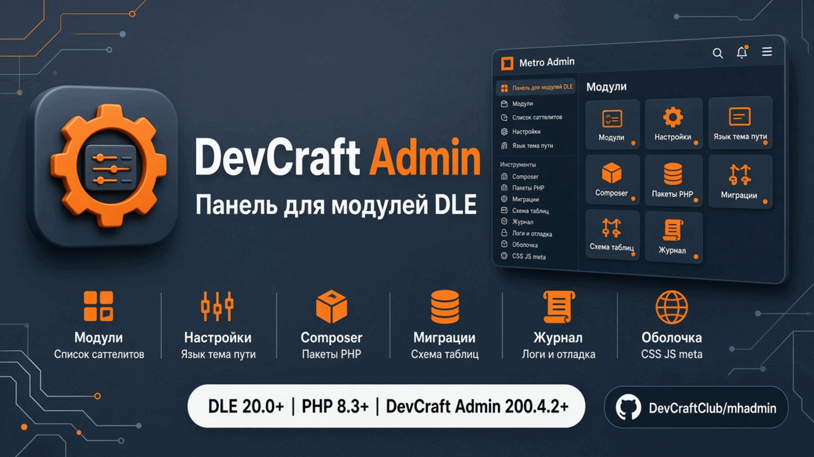

<p align="center">
  
</p>

[](https://github.com/DevCraftClub/mhadmin/issues)[](https://github.com/DevCraftClub/mhadmin/network)[](https://github.com/DevCraftClub/mhadmin/blob/master/LICENSE)

# DevCraft Admin


Административная панель для моих модулей для движка DLE. Основная часть функционала будет основана на JS/CSS framework [Metro UI](https://metroui.org.ua/) и шаблонизаторе [Twig](https://twig.symfony.com/).

## ⚠️ Несовместимость с MH Admin (legacy)

Эта версия DevCraft Admin (**200.4.0**) **не обратно совместима** с MH Admin (legacy maharder).

- Composer-сервисы перенесены в `devcraft/src/classes/Composer/` (Core API)
- Внутренние Composer-сервисы модуля Admin удалены
- Детальный просмотр лога: `?mod=devcraft&action=logs&uuid=…`
- Сайт: https://devcraft.club/
- Документация: https://readme.devcraft.club/
- Миграция: см. раздел Migration в документации


## Установка / обновление

Скачать: [DevCraft Admin](https://devcraft.club/downloads/maharder-assets.4/).  
Полная инструкция: [документация — Установка](https://readme.devcraft.club/latest/dev/dle/devcraft_admin/install).

Ставите на **DLE 20.0+** — нужна линейка плагина **`200.*`**.

### Требования

- PHP **8.3+**
- Расширения: `simplexml`, `libxml`, `intl`, `fileinfo`, `pdo_mysql`, `curl`, `mbstring`, `openssl`
- В `disable_functions` не должно быть `exec` и `putenv` (иначе Composer в админке не ставит пакеты)
- Память PHP не менее 128M
- DataLife Engine **20.0+**

### Установка

**1. Менеджер плагинов DLE**

1. Загрузите архив (`upload/` + `install.xml` в корне).
2. Панель → Плагины → Установить.
3. Проверьте на диске: `engine/inc/devcraft.php` и каталог `devcraft/`.

**2. Composer**

В каталоге `devcraft/` на сервере:

```bash
cd devcraft
composer install --no-dev
```

Без `vendor/` плагин выведет предупреждение в админке и не загрузится.

**3. Вручную**

Скопируйте содержимое `upload/` в корень сайта, затем активируйте плагин в DLE.

### Первый запуск

1. Откройте **DevCraft Admin** в админке DLE.
2. **Настройки** — язык, тема, пути.
3. При необходимости — журнал и уведомления.

### Обновление

1. Сделайте запасную копию `devcraft/` и настроек.
2. Установите новый архив через менеджер плагинов DLE.
3. При смене lock снова выполните `composer install`.
4. Сверьте [историю изменений](https://readme.devcraft.club/latest/dev/dle/devcraft_admin/changelog) и `composer_required` модулей.